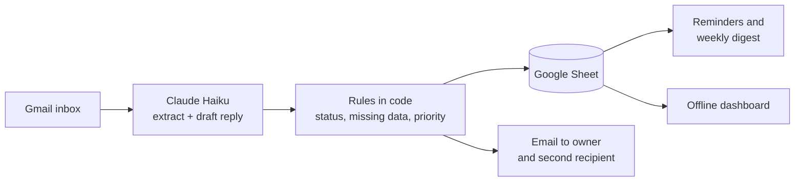

# Joinery Inquiry Intake

Lead capture and qualification automation for carpentry and joinery businesses. It reads customer inquiries from a Gmail inbox, uses Claude to pull out the details, saves them to a colour-coded Google Sheet, and emails the owner a summary with a ready-to-edit draft reply. It also reminds the owner about leads left waiting.

Built as a reusable template: one config file per business, no servers, and a running cost of well under R3 (about $0.15) a month. **All data in this repository is fictional.**

## What it does

- **Captures inquiries** from one Gmail address (a `+inquiries` alias).
- **Extracts** name, contact details, project type, location, description and timeline with Claude Haiku, plus an urgency flag and a one-line summary.
- **Records** each inquiry in Google Sheets with a unique reference ID (`JNR-YYYYMMDD-###`), a status, and a priority (Hot, Warm or Cold).
- **Flags missing information** and drafts a polite reply asking for it. The owner reviews it. Nothing is sent to customers automatically.
- **Notifies** the owner, and anyone on the notification list, by email.
- **Prevents duplicates**: re-running never adds a row twice, and repeat messages are marked `Duplicate`.
- **Reminds** the owner once when an open lead has waited more than 48 hours, and sends a weekly digest.
- **Handles errors**: retries with backoff, an `Error` row for any email it cannot process, and a failure email.
- **Optional dashboard**: one offline HTML page with key numbers, charts and a searchable list.

## How it works



The AI only reads text and writes text. Status, missing data and priority are worked out by plain code so results are consistent. Email content is treated as untrusted. A fuller diagram with the error paths is in [docs/diagram.md](docs/diagram.md).

### Statuses and priority

| Status | Set by | Meaning |
|---|---|---|
| New | system | Complete inquiry |
| Needs info | system | Something important is missing |
| Duplicate | system | Same sender and text as an earlier inquiry |
| Spam | system | Not a real inquiry |
| Error | system | The email could not be processed |
| Contacted, Quoted, Won, Lost | owner | Typed into the Status cell as the lead moves on |

Priority applies to New and Needs info only. **Hot**: urgent, or needed within about 4 weeks. **Warm**: relaxed timeline, or one detail missing. **Cold**: needed in over about 12 weeks, or several details missing.

## Quick start

### 1. Requirements
- Python 3 (tested on 3.14) and `pip install -r requirements.txt`. The project itself only needs `requests`. `google-auth-oauthlib` is used only by the one-off sign-in helper in step 2.
- An [Anthropic API key](https://console.anthropic.com/). Usage is pay-per-use.
- A Google account that will receive the inquiries.

### 2. Google sign-in
The script uses an OAuth refresh token with these scopes only:

- `https://www.googleapis.com/auth/gmail.readonly` (read inquiries)
- `https://www.googleapis.com/auth/gmail.send` (send alerts)
- `https://www.googleapis.com/auth/drive.file` (create and edit only the Sheet the script creates)

One-time setup:
1. In the [Google Cloud Console](https://console.cloud.google.com/), create a project and enable the **Gmail API** and **Google Sheets API**.
2. Configure the OAuth consent screen and add your Google account as a test user.
3. Create an OAuth client of type **Desktop app**. Copy its client ID and secret into `.env` (step 3 below).
4. Run `python scripts/google_auth.py`. It opens a browser sign-in and saves `GOOGLE_REFRESH_TOKEN` into `.env`.

### 3. Configure
```
cp .env.example .env                    # Windows: copy .env.example .env
cp config.example.json config.json      # Windows: copy config.example.json config.json
```
Paste your keys into `.env`. It needs `ANTHROPIC_API_KEY`, `GOOGLE_CLIENT_ID`, `GOOGLE_CLIENT_SECRET` and `GOOGLE_REFRESH_TOKEN`. Both `.env` and `config.json` are git-ignored, so your keys and addresses stay local.

Then edit `config.json` for the business. At minimum replace `owner_email`, `notify_also`, `inquiry_address` and `gmail_query` (every `YOUR_ADDRESS` and `example.com` placeholder).

### 4. Run
```
python src/run.py --dry-run    # extract and print only: no sheet writes, no emails
python src/run.py              # live run (creates the Sheet on the first run)
python src/run.py --dashboard  # live run, then rebuild dashboard/index.html
python src/run.py --digest-now # send the weekly digest now (testing)
python src/dashboard.py        # rebuild the dashboard only (contacts masked)
```
The first live run creates a Google Sheet in your Drive and stores its ID in `state.json`. To use an existing one set `SHEET_ID` in `.env`.

### 5. Schedule
Run `python src/run.py` every 15 minutes with Windows Task Scheduler, cron (`*/15 * * * * cd /path/to/project && python src/run.py`), or a scheduled GitHub Action. Runs with no new email make no AI calls and cost nothing. See [docs/handoff.md](docs/handoff.md) for details and limits.

### 6. Try it with fictional data
`tests/samples/inquiries.json` holds 10 fictional inquiries (complete, vague, urgent, duplicate, spam, Afrikaans, and a prompt-injection attempt). With `inquiry_address` set in `config.json` to your own `+inquiries` alias:
```
python tests/send_samples.py --confirm
python src/run.py
```

## Configuration (`config.json`)

| Key | Meaning |
|---|---|
| `business_name` | Used in draft replies and the dashboard |
| `owner_email` | Receives alerts and failure emails |
| `notify_also` | Extra addresses that get the same alerts, reminders and digest |
| `inquiry_address` | The `+inquiries` alias customers write to. Used by `tests/send_samples.py` |
| `gmail_query` | Gmail search that defines an inquiry |
| `max_emails_per_run` | Safety cap per run |
| `stale_hours` | Hours before the one-off reminder (default 48) |
| `digest_day`, `digest_hour` | Weekly digest timing (default Monday, from 08:00 local) |
| `sheet_title` | Name of the Sheet created on first run |
| `model` | Claude model. Default `claude-haiku-5-5` |
| `max_output_tokens`, `max_body_chars` | Cost caps |
| `retries`, `backoff_seconds` | Retry behaviour |
| `dashboard_mask_contacts` | Mask emails and phones in the dashboard (default on) |

## Project structure

```
src/
  run.py                  main script: fetch, extract, write, alert
  extract.py              Claude prompt, parsing, status and priority rules
  notify.py               reminders and weekly digest
  dashboard.py            builds dashboard/index.html
  dashboard_template.html the dashboard page
  google_api.py           Gmail and Sheets calls
  sheet_format.py         Sheet styling and status colours
  schema.py               Sheet columns
  common.py               config, logging, retries
scripts/google_auth.py    one-off Google sign-in helper (writes the refresh token to .env)
tests/                    offline unit tests and the sample inquiries
docs/                     SOP, handoff, cost estimate, diagram
config.example.json       per-business settings (copy to config.json)
.env.example              names of the secrets (copy to .env and fill in)
requirements.txt          Python dependencies
```

## Tests
```
python -m unittest discover -s tests
```
The 22 unit tests run offline, with no network and no credentials.

## Cost
About **$0.00024 per inquiry** on Claude Haiku 5.5 (roughly R0.004), measured on a live run. Everything else (Gmail, Sheets, hosting, reminders, digest, dashboard) is free. Details: [docs/cost-estimate.md](docs/cost-estimate.md).

## Security and privacy
- Secrets live only in `.env`, which is git-ignored. Never commit it.
- The Google sign-in is limited to the three scopes above. The script cannot delete mail.
- Inquiry text is sent to Anthropic's API and stored in your Google Sheet. Check Anthropic's terms and POPIA/GDPR obligations before using real customer data.
- The dashboard masks emails and phone numbers by default. Publish only a masked build made from fictional data.
- AI drafts are suggestions. The prompt bans prices and promised dates, but always read a draft before sending it.

## Known limitations
- **Google sign-in expiry:** while the Google Cloud app is in "Testing" mode, the refresh token expires after 7 days, the run stops, and no alert is sent (alerts use the same login). Re-run `python scripts/google_auth.py` to get a new token. Publishing the app, or using a Google Workspace internal app, removes the limit.
- One run at a time. Do not schedule overlapping runs.
- The weekly digest marker is stored in the local `state.json`, so on hosts without a persistent disk the digest can repeat.
- Attachments and images are ignored.
- Tested on short English inquiries and one Afrikaans sample, with fictional data only.

## Documentation
- [SOP for the business owner](docs/sop.md)
- [Technical handoff](docs/handoff.md)
- [Cost estimate](docs/cost-estimate.md)
- [Workflow diagram](docs/diagram.md)

## Licence
[MIT](LICENSE). You are free to use, modify and sell this software, including for commercial work, as long as the copyright notice is kept.
