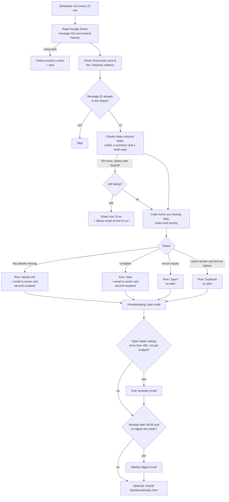

# Workflow diagram

Renders on GitHub and in VS Code (Markdown preview with Mermaid support).

## Notes
- Every row gets a reference ID: `JNR-YYYYMMDD-###`, and a priority (Hot, Warm or Cold) for open leads.
- Duplicates are caught twice: by Gmail message ID (re-runs) and by a hash of sender plus text (repeat sends).
- The AI only reads and writes text. It never contacts customers, and email text cannot change what the code does.
- Human step: the owner reads each alert, checks the draft reply, replies to the customer, then moves the Status on (Contacted, Quoted, Won or Lost). That is also what stops reminders.
